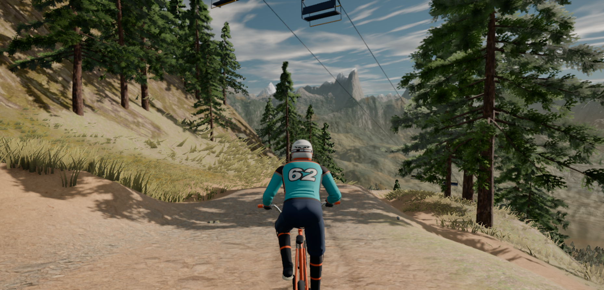

# BMX MOUNTAIN — offline mirror

Full mirror of **BMX Mountain** (https://wavedash.com/games/bmx-mountain).

Source: https://wavedash.com/games/bmx-mountain



## Stack

- **Custom Vite production build** (engine `CUSTOM` on the platform) — entry
  `index.html` + one minified ESM bundle `assets/index-gCVK5XnX.js` (1.31 MB)
  and four module workers (`horizon`, `cover`, `deerSkin`, `natural`).
- **three.js r186 bundled into the entry chunk** — the node/TSL system and the
  `WebGPURenderer`/`WebGLRenderer` cores are minifier-merged into
  `assets/index-gCVK5XnX.js` (registered at `window.__THREE__ = "186"`); the
  game targets WebGPU with a WebGL2 fallback.
- **Fully procedural world** — terrain, trees, rocks, the rider, the bike, the
  deer herd and the lodge are generated in code (signed-distance/triplanar
  textures + skinned procedural meshes); there are no model files at all.
- **Wavedash platform glue** — `embed` (HTML shell), `embed.js` (embed SDK),
  `embed.css`, `sw-embed.js` (service worker) serve the build on the platform;
  the game itself only needs `index.html`, `assets/`, `tex/` and `sfx/`.
- **Payload set** — 24 WebP textures (`tex/`) and 45 WAV effects (`sfx/`);
  no fonts ship (CSS system-font stacks only).

## What this is

BMX Mountain (wavedash.com/games/bmx-mountain) — "Bomb down a steep, fast dirt
trail through pine forest and golden aspens, carving berms, pumping rollers and
launching off jumps with snowy peaks all around": a 3D mountain-bike descent
game by the Wavedash developer **@portner**, played in the browser on the
Wavedash platform (keyboard/mouse and controller). The mountain carries a live
multiplayer presence on the platform ("N on the mountain").

Capture-class mirror: the game is NOT served from `wavedash.com`. The platform
server-renders the game page with a per-load bootstrap (`playKey`, `gameCloudId`,
`gameBuild` metadata) and the build runs in an iframe on a per-build CDN host

```
https://<gameCloudId>-<fnv32(userId)>-<fnv32(gameBuildId)>.builds.wavedashcdn.com
```

whose `/embed` shell mints a ~1 h gameplay JWT; every build-file request then
travels with `Authorization: Bearer <jwt>` + `X-Wd-Sw: jwt` (what
`sw-embed.js` adds in a browser). The mirror captures the build host's closure
at the repo root (repo root == CDN host root), so a static server reproduces
the game's own request graph: `index.html` → `./assets/index-gCVK5XnX.js` →
the four workers + `tex/*.webp` + `sfx/*.wav`.

Build at capture (2026-10-13): `gameBuild mn79ffen43qqtarbeqsw0mkvdh8g34bf`,
buildNumber 86, engine `CUSTOM`, entrypoint `index.html`, `buildSizeBytes`
17,271,305. The captured closure is 79 files / 18,043,450 bytes — the build
payload plus the platform's public embed files (`embed.js` 732,728 +
`sw-embed.js` 30,200 + `embed.css` 9,831 B ≈ 772 KB); a ~614 B remainder of the
upload-side build record is not reachable by any runtime request.

External at runtime (platform backend, never part of the closure):
`convex-api.wavedash.com` (realtime backend behind the Wavedash SDK),
`uploads.wavedash.com` / `ugc.wavedashcdn.com` (UGC/cloud saves),
`o4510067032457216.ingest.us.sentry.io` (SDK telemetry),
`accounts.google.com` (sign-in iframe on the platform page) and the platform
auth endpoints `/auth/token` + `/auth/refresh` (dynamic JWT mint/refresh —
documented, never captured). Playing the mirror standalone is offline: no
platform session, no cloud saves, no other riders.

§0.4 fork-over-mirror checked 2026-10-13: the page credits the game to the
platform developer **@portner** and links no public source repository (the only
`github.com` URL in the bundle is three.js's own issue link inside the vendored
library; `github.com/wvdsh` is the platform org, not this game's source). No
upstream repo to fork — the mirror stands.

## Layout

- `index.html`, `assets/`, `tex/`, `sfx/` — the game's own closure (entry,
  bundle + module workers, textures, sounds), byte-exact as served
- `embed`, `embed.js`, `embed.css`, `sw-embed.js` — the platform's embed shell /
  SDK / service worker as served on the same host (`embed` is dynamic — the
  rotating JWT/sessionToken snapshot; `embed.js`/`embed.css`/`sw-embed.js` are
  the public platform files)
- `.upstream/manifest.json` — sha256 for every captured file (79; `embed`
  marked `dynamic`)
- `readable/` — prettified derived layer (pinned prettier 3.9.6, fixed point)
  for the five game JS chunks, `embed.js`, `sw-embed.js`, the stylesheet, and
  the inline-block twins from `index.html` + `embed`
- `src/` + `split-spec.json` — statement-aligned slices of the app chunks with
  the recorded derivation spec
- `docs/` — cover, boot evidence, network log
- `tools/derive.mjs` — rebuild `readable/` + `src/` + `split-spec.json`
- `tools/scan.mjs` — closure scanner (referenced-but-missing files)
- `tools/capture.mjs` — reproducible bootstrap + re-fetch path (PLAN §3)
- `tools/update.mjs` — read-only drift probe against the live platform
- `tools/verify.mjs` — re-hash the capture against the manifest
- `tools/audit.js` — integrity gate for the derived layers (`AUDIT PASS`)
- `tools/serve.mjs` — minimal static server for boot tests

## Assets

- **textures** — 24 file(s): `tex/` (8 ground sets × colour+normal WebP:
  `aerial_grass_rock`, `aerial_rocks_02`, `dirt_floor`, `forest_floor`,
  `forrest_ground_01`, `mossy_rock`, `rocky_trail`, `snow_02`; bark
  `bark_pine`/`bark_birch` colour+normal; leaf masks `leaf_pine`/`leaf_aspen`;
  `wood_rough` colour+normal)
- **audio** — 45 file(s): `sfx/` (ride loops `roll_dirt`/`roll_gravel`/
  `pedal_chain`/`hub_buzz`/`skid_gravel`, ambience `amb_birds`/`amb_breeze`/
  `amb_creek`, impacts `land0-4`/`bikefall0-2`/`bodyfall`/`wood0-2`, water
  `splash0-1`/`slosh0-2`, human `grunt0-2`/`hurt0-2`/`breath`, UI `click0-11`)
- **models** — none — the world, rider, bike and deer are procedural (no
  glTF/GLB anywhere in the closure)
- **fonts** — none — the platform CSS and game UI use system font stacks
- **code payloads** — 5 file(s): `assets/` (entry bundle + `horizon`/`cover`/
  `deerSkin`/`natural` module workers)
- **platform** — 4 file(s): `embed`, `embed.js`, `embed.css`, `sw-embed.js`

## Run

Open `index.html` through any static file server (the capture is a static
site; no build step):

```
node tools/serve.mjs 8747        # or: npx serve .
```

then open `http://127.0.0.1:8747/`. The game boots straight from local files
(no platform session — the platform-only extras such as cloud saves and other
riders stay external).

## Verify

```
node tools/verify.mjs     # re-hash the capture against the manifest
node tools/audit.js       # derived-layer integrity gate
```

## Updating from upstream

```
node tools/update.mjs     # read-only drift probe: what changed upstream
```

The probe never rewrites the capture — a mirror is a point-in-time snapshot.
It re-derives the platform host, mints a fresh gameplay JWT via `/embed` and
re-hashes every captured file against the live build (build-id changes show up
as a `<build>` row). Refreshing means re-running `tools/capture.mjs` into a
clean tree and re-cutting the derived layers on top of the new build
(`node tools/derive.mjs && node tools/audit.js`).

Known platform noise: the game page occasionally answers a smaller
client-rendered variant (no `playKey`/`gameBuild` in the HTML) — the probe
fails loudly in that case and succeeds on retry.

### 2026-10-13 readable/src derivation

Both queued derived layers are in place, cut from the recorded capture
(capture bytes untouched — `node tools/verify.mjs` re-hashes all 79 files):

- `readable/` — pinned prettier 3.9.6 (module API, default options, applied to
  a verified fixed point — ≤4 passes; one pass stabilizes every file except
  the main game bundle, which needs two; never the CLI, it respects
  `.gitignore` and can silently echo its input) rendered the five game chunks
  to `*.pretty.js` (69,249 + 1,291 + 823 + 226 + 170 lines), `embed.js` +
  `sw-embed.js` (23,054 + 1,828 lines), the stylesheet to `embed.pretty.css`
  (636 lines) and the two inline blocks (`embed-inline-1.pretty.js`,
  `index-inline-1.pretty.css`) — 10 files total. Every pretty is provably not
  a byte copy of its capture source and re-renders byte-exact under the pinned
  version (fixed-point recipe).
- `src/` — 75 statement-aligned slices (`src/<tag>-NN.js`, exact 2-line
  provenance header) recorded in `split-spec.json` (82 sections): 75/75 parse
  standalone (`node --input-type=module --check -`) and round-trip byte-exact
  to their readable line ranges. Cuts land on top-level declaration boundaries
  (~250-350 line windows); oversized single declarations stay whole. The main
  entry chunk's 69,249 readable lines yield 71 slices — the first is a
  recorded `boundary` fragment: the minifier merged the app's opening constants
  into the same `var` declaration that closes the three.js region, so that
  slice starts mid-declaration (still byte-exact and standalone-parsing).
  Identification is the bundle's own minified names — the rename campaign
  (PLAN §5) remains an open task.
- Vendor rule — wholeFile sections, never sliced: the bundled three.js r186
  region inside `assets/index-gCVK5XnX.js` (core + node/TSL +
  WebGPURenderer/WebGLRenderer, content-anchored and guarded), the Vite
  modulepreload polyfill opening that chunk, `embed.js` (Wavedash platform
  embed SDK), `sw-embed.js` (embed service worker) and `embed.css`
  (stylesheet). The `embed` shell's inline `window.__WAVEDASH_GAME__` boot
  script is a wholeFile twin backed by `readable/index-inline-map.json` (its
  bytes rotate per session — JWT/sessionToken).
- Binary payloads are sha256-recorded `notRendered` (69 files: `tex/*.webp`,
  `sfx/*.wav`) — served byte-exact, never text-derived, never re-encoded.
- Gates: `node tools/verify.mjs` → `79 files checked, 0 problems`;
  `node tools/audit.js` → `AUDIT PASS` (75/75 round-trips, 10/10 pretties
  re-render byte-exact, 82 sections, 4/4 worker imports resolve, 69/69
  notRendered payloads byte-exact); `node tools/update.mjs` → `up to date:
  79 captured files identical upstream (build 884b3fbd)`; serve probe — the
  mirror root served on loopback (`http://127.0.0.1:8747/`), the game booted
  from local files and was played (cover shot mid-trail on the descent), the
  listener PID killed and the port proven closed (`netstat`).
- §0.4 fork-over-mirror checked 2026-10-13 — no public source repo exists for
  BMX Mountain (see "What this is"), so the mirror stands.

## Mirror conventions

- **Capture layer** — the captured files are byte-exact copies of what the
  origin served; nothing in them is edited.
- **Readable layer** — `readable/` is derived (prettified) and never shipped to
  a browser; it exists so the bundle can actually be read.
- **Provenance** — `.upstream/manifest.json` records sha256 for each captured
  artifact, and `tools/verify.mjs` re-checks it.
- **Drift** — `tools/update.mjs` is read-only: it reports what changed upstream
  and never rewrites the capture.

## Fleet status

<!-- mirror-status:start — feeds _standard/REPO-INDEX.md. Update ONLY your own mirror's block; never edit the shared index (PLAN §8). Rebuild: node _standard/build-index.mjs -->
<!-- cols: cls=classification · ver=verify 0 problems · upd=drift probe · man=manifest · rdbl=readable re-derived · src=reversed src · boot=boot test · top=offline-mirror topic · tag=backup tag · staged=staged not committed -->
| # | repo | cls | ver | upd | man | rdbl | src | boot | top | tag | staged |
|---|---|---|---|---|---|---|---|---|---|---|---|
| 312 | bmx-mountain | mirror | ✓ | ✓ | ✓ | ✓ | ✓ | ✓ | ✓ | — | — |
<!-- mirror-status:end -->
